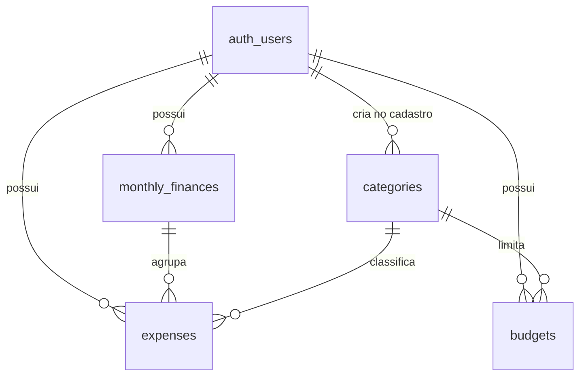

# Banco de dados (Supabase / PostgreSQL)

## Como aplicar

1. Abra seu projeto no [painel do Supabase](https://supabase.com/dashboard).
2. Vá em **SQL Editor** → **New query**.
3. Cole o conteúdo de `migrations/0001_initial_schema.sql` inteiro e clique em **Run**.
4. Confira em **Table Editor**: devem aparecer 4 tabelas novas — `categories`, `monthly_finances`, `expenses`, `budgets`.

Rodar o script mais de uma vez dá erro (as tabelas já existem) — isso é esperado, não precisa rodar de novo depois que funcionar.

## Decisões de design

- **Sem tabela `users` própria.** O Supabase Auth já mantém `auth.users` automaticamente. Todas as tabelas abaixo referenciam `auth.users(id)` diretamente, em vez de duplicar.
- **RLS habilitado desde já**, não só na Etapa 12. A chave publishable só é segura de usar com Row Level Security configurado — deixar isso em aberto por várias etapas deixaria dados financeiros reais desprotegidos. Cada tabela tem 4 políticas (select/insert/update/delete), todas na forma `auth.uid() = user_id`: cada usuário só enxerga e mexe no que é dele.
- **Categorias são por usuário, não globais.** Um gatilho (`handle_new_user`) roda automaticamente sempre que alguém se cadastra (insert em `auth.users`) e cria uma cópia das 10 categorias padrão para aquele usuário. Isso bate com o que o documento original pedia (categoria tem campo "Usuário") e permite que cada um renomeie/exclua as suas sem afetar ninguém.
- **Dinheiro como `numeric(12,2)`, nunca float.** Ponto flutuante arredonda errado — inaceitável pra valores financeiros.
- **`expenses` se liga a `monthly_finances` por `monthly_finance_id`**, não por mês/ano soltos — é o relacionamento que o documento original desenhava (usuário → mês → gastos) e evita duplicar a mesma informação em dois lugares.
- **Excluir uma categoria com gastos nela é bloqueado** (`on delete restrict` em `expenses.category_id`; no PostgreSQL 18+ o erro vem com o código `23001`, antes `23503`, e o backend trata os dois) — não dá pra perder histórico financeiro sem querer. Isso pode ser revisto na Etapa 7, quando a exclusão de categorias for implementada de verdade.
- **`updated_at` atualiza sozinho** via gatilho, em `monthly_finances`, `expenses` e `budgets`.

## Esquema

| Tabela | Campos principais | Observação |
|---|---|---|
| `categories` | `name`, `description` | 10 padrão por usuário, criadas automaticamente |
| `monthly_finances` | `month`, `year`, `salary` | 1 linha por usuário+mês+ano (unique) |
| `expenses` | `description`, `amount`, `type` (fixo/variavel), `expense_date`, `notes` | liga a `monthly_finances` e a `categories` |
| `budgets` | `category_id`, `month`, `year`, `limit_amount` | as "caixinhas", 1 por usuário+categoria+mês+ano |

## Testado antes da entrega

Rodei a migração inteira num Postgres local (simulando `auth.users` e `auth.uid()`) e validei: o gatilho semeia as 10 categorias em novos usuários, o RLS isola corretamente dois usuários diferentes, o fluxo salário → gasto soma certo, e as constraints (mês inválido, tipo inválido, valor negativo, mês/ano duplicado) bloqueiam como esperado. Não foi possível testar contra o seu projeto real — meu ambiente não alcança a internet — então a validação final é você rodar o script e conferir o Table Editor.

## Scripts

| Script | Quando rodar |
|---|---|
| `migrations/0001_initial_schema.sql` | **Sempre, uma vez, primeiro.** Cria as tabelas, o RLS e os gatilhos |
| `migrations/0002_backfill_default_categories.sql` | **Só se** o seletor de categorias do formulário de gastos vier vazio. Acontece com contas criadas *antes* do gatilho da Etapa 3 (ele só semeia as categorias de quem se cadastra depois). Cria as 10 categorias padrão apenas para quem não tem **nenhuma**; pode ser rodado mais de uma vez e não recria categorias que alguém apagou de propósito |
| `migrations/0003_security_hardening.sql` | **Uma vez, depois da 0001** (Etapa 12). Reforça a segurança: chaves estrangeiras do mesmo dono, políticas só para logados, limites de texto e funções protegidas |
| `migrations/0004_mfa_enforcement.sql` | **Uma vez, depois da 0003** (Etapa 15). Quem ativou o app autenticador só lê e grava os dados depois de digitar o código (sessão `aal2`) |
| `migrations/0005_profile.sql` | **Uma vez, depois da 0004** (Etapa 18). Perfil (`profiles`), fotos (bucket `avatars`), funções de sessões ativas e a regra que derruba na hora o token de uma sessão encerrada |
| `migrations/0006_dashboard_panels.sql` | **Uma vez, depois da 0005.** Ordem e ícone dos painéis do Resumo (`profiles.dashboard_panels`), escolhidos em Configurações |
| `migrations/0007_demo_account.sql` | **Uma vez, depois da 0006, só se for publicar com conta de demonstração.** Trava senha, e-mail, MFA, nome, telefone, foto e sessões da conta marcada em `private.demo_accounts` |
| `checks/verificar_seguranca.sql` | **Quando quiser.** Só lê o banco e mostra ✅/❌ para cada item de segurança |

Novas mudanças de schema devem virar `0006_*.sql`, `0007_*.sql` etc. — nunca edite um script depois que ele já tiver sido rodado em algum ambiente.

## Segurança (Etapa 12)

A migração `0003_security_hardening.sql` reforça o que a Etapa 3 já fazia:

- **Chaves estrangeiras "do mesmo dono".** Antes, as chaves estrangeiras ignoravam o RLS: alguém acessando a API do Supabase diretamente, com o próprio login, conseguia criar um gasto *seu* apontando para a categoria ou o mês de outra pessoa, desde que soubesse o UUID. Agora as chaves são compostas, `(id, user_id)`, e a linha referenciada precisa ter o mesmo dono. O banco recusa sozinho, sem depender do backend.
- **Políticas só para usuários logados** (`to authenticated`). Visitante sem login (papel `anon`) não tem nenhuma política, então não lê nem grava nada.
- **`(select auth.uid())` nas políticas**: o Postgres calcula o id do usuário uma vez por consulta, não uma vez por linha. O resultado é o mesmo, mais rápido, e é o formato que o Advisor do Supabase recomenda.
- **Limites de texto também no banco** (nome da categoria ≤ 60, descrição da categoria ≤ 200, descrição do gasto ≤ 120, observação ≤ 500), os mesmos que o backend já valida.
- **Funções com `search_path` fixo**, e `handle_new_user` (que roda com permissões elevadas) não pode mais ser chamada pela API. O gatilho de cadastro continua funcionando normalmente.

Ela roda dentro de uma transação: se algo falhar, nada é aplicado.

### Como conferir

Depois de rodar a `0003`, rode `checks/verificar_seguranca.sql` no SQL Editor. Ele só lê, não altera nada, e mostra uma tabela com ✅ ou ❌ em cada item. Tudo deve aparecer com ✅.

### Testado antes da entrega

As migrações `0001` → `0002` → `0003` foram rodadas num PostgreSQL 18 local, simulando `auth.users`, `auth.uid()` e os papéis `anon` e `authenticated` do Supabase, com dois usuários de teste. Resultado:

- Antes da `0003`, a lacuna foi reproduzida: o banco aceitou um gasto do usuário A com a categoria do usuário B.
- Depois da `0003`, os 28 testes passaram: isolamento entre usuários nas 4 tabelas; FKs recusando mês e categoria de outro dono (insert e update); caminho normal funcionando; exclusão de categoria com gastos bloqueada; limites de texto; `anon` sem acesso; gatilho de cadastro criando as 10 categorias; exclusão de conta apagando em cascata só os dados daquela conta.
- O `verificar_seguranca.sql` mostrou ❌ antes e ✅ em tudo depois.

Rodar a `0003` uma segunda vez dá erro logo no primeiro comando (a constraint já existe), sem alterar nada. Isso é esperado.

## Verificação em duas etapas (Etapa 15)

A migração `0004_mfa_enforcement.sql` cria `private.mfa_satisfied()` e uma política **restritiva** (`<tabela>: mfa`) em cada uma das 4 tabelas. Uma política restritiva se soma às da `0003`: para ler ou gravar, a pessoa precisa ser a dona da linha **e**, se tiver um app autenticador confirmado, estar numa sessão `aal2` (que digitou o código).

- A função fica no schema `private`, que a API do Supabase não expõe, e é `security definer` porque precisa ler `auth.mfa_factors`, que o papel `authenticated` não lê. Tem `search_path` vazio, como as outras, e visitantes (`anon`) não podem chamá-la.
- Um app só lido no QR Code, mas nunca confirmado com um código, não conta: não tranca ninguém para fora.

### Testado antes da entrega

A `0004` foi aplicada depois de `0001` → `0003` num PostgreSQL 18 local, simulando `auth.uid()`, `auth.jwt()` e `auth.mfa_factors`:

- **Usuário com app confirmado:** em `aal1` viu 0 categorias, teve o insert recusado pela política `monthly_finances: mfa`, e update e delete afetaram 0 linhas. Em `aal2`, leu as 10 categorias e gravou normalmente.
- **Usuário com cadastro pela metade:** em `aal1` continuou vendo os próprios dados e nenhum dado de outra pessoa.
- **Novo cadastro:** o gatilho continuou criando as 10 categorias.
- **Permissões:** `anon` não consegue chamar a função, e `authenticated` não lê `auth.mfa_factors`.
- **Verificação de segurança:** o `verificar_seguranca.sql` mostrou ❌ nos itens novos antes da `0004` e ✅ em tudo depois.

## Minha conta (Etapa 18)

A migração `0005_profile.sql` cria o que a página **Minha conta** precisa. A regra que guia tudo: **o dono é sempre `auth.uid()`**, o usuário do token assinado pelo Supabase. Nenhuma tabela ou função aceita um id de usuário vindo de fora.

- **`public.profiles`**: uma linha por conta, com o **mesmo id** de `auth.users` (chave primária e estrangeira ao mesmo tempo; não existe "id do perfil" separado). Guarda nome, telefone (formato internacional, `+5511987654321`), o caminho da foto e as preferências (idioma `pt-BR`/`en`, tema `auto`/`light`/`dark` e três avisos liga/desliga). RLS: só `auth.uid() = id` lê, cria e altera; não há política de exclusão (o perfil some junto com a conta, em cascata). Tem a mesma política restritiva de MFA das outras tabelas. Os limites (nome ≤ 100, telefone E.164, idioma e tema da lista, foto **só na pasta do dono**) estão em *check constraints*, iguais aos do backend.
- **Perfil automático**: um gatilho cria o perfil de cada conta nova, e a própria migração cria o das contas que já existiam.
- **Bucket `avatars`** (Supabase Storage), **privado**, até 2 MB, só JPEG/PNG/WebP. As 4 políticas de `storage.objects` exigem que a primeira pasta do caminho seja o id de quem está logado (`<id>/foto.jpg`), além de MFA e sessão ativa.
- **Sessões ativas**: `auth.sessions` não é exposta pela API, então o acesso é por três funções `security definer`, com `search_path` vazio e sem acesso de visitantes:
  - `list_my_sessions()`: as sessões de quem chamou (aparelho, IP, último uso, se tem o código do app e qual é a atual);
  - `revoke_my_session(id)`: encerra **uma** sessão, só se for de quem chamou e não for a atual. Devolve `false` tanto para "não existe" quanto para "é de outra pessoa", de propósito;
  - `revoke_my_other_sessions()`: encerra todas, menos a atual.
- **Sessão encerrada cai na hora**: o token do Supabase vale até 1 hora e continuaria aceito pela API mesmo depois de a sessão ser apagada. A função `private.session_active()` confere se a sessão do token (`session_id`) ainda existe, e entra como política **restritiva** (`<tabela>: sessão ativa`) nas 5 tabelas e nas fotos. Encerrou, o token para de ler e gravar no mesmo instante, mesmo falando direto com a API do Supabase.

Roda dentro de uma transação. Depois dela, o `verificar_seguranca.sql` ganha 13 itens novos, todos ✅.

### Testado antes da entrega

A `0005` foi aplicada depois de `0001` → `0004` num PostgreSQL 18 local, simulando `auth.users`, `auth.sessions`, `auth.refresh_tokens`, `auth.mfa_factors`, `auth.uid()`, `auth.jwt()`, o schema `storage` (com `storage.foldername`) e os papéis `anon` e `authenticated`, com duas contas que já existiam antes da migração. Os 31 cenários passaram:

- **Backfill e gatilho**: as duas contas antigas ganharam perfil com os padrões; uma conta nova ganhou perfil e as 10 categorias; excluir a conta apagou o perfil.
- **Isolamento do perfil**: Ana vê só o próprio; o `update` no perfil da Bia afeta 0 linhas; trocar o próprio `id` para o da Bia e inserir um perfil com o id da Bia são recusados pelo RLS.
- **Limites**: telefone sem `+`, foto apontando para a pasta da Bia e idioma `fr` são recusados pelas *check constraints*.
- **Sessões**: Ana lista as 3 sessões dela (a atual primeiro); não consegue encerrar a da Bia nem a atual; encerra a do celular (e o *refresh token* dela some em cascata); "encerrar as outras" apaga só o que sobrou dela; um token sem `session_id` não apaga nada.
- **Sessão encerrada**: com o token da sessão já encerrada, o banco devolve 0 categorias e 0 perfis e recusa gravar (`monthly_finances: sessão ativa`). Com o token da sessão ativa, tudo normal.
- **Fotos**: Ana grava na própria pasta, não grava na da Bia; a Bia não vê nem apaga a foto da Ana.
- **MFA**: depois de a Ana ativar o app, uma sessão `aal1` vê 0 perfis, 0 sessões e 0 fotos e não consegue encerrar sessões (`mfa_required`); em `aal2`, funciona.
- **Permissões**: `anon` não chama as funções de sessões nem vê perfis; `handle_new_user_profile` não pode ser chamada pela API.
- **Verificação**: o `verificar_seguranca.sql` mostrou os 13 itens novos com ❌ antes da `0005` e 32 de 32 ✅ depois.

Não foi possível rodar contra o seu projeto real. Dois pontos dependem do Supabase de verdade e valem conferir depois de rodar: o papel `postgres` (dono das funções) precisa poder apagar linhas de `auth.sessions` (a página Minha conta → Segurança → **Encerrar** mostra o erro se não puder), e o token precisa trazer o `session_id` (os tokens atuais do Supabase trazem).

## Painéis do Resumo (0006)

A migração `0006_dashboard_panels.sql` adiciona `profiles.dashboard_panels` (`jsonb`): a ordem e o ícone dos 6 painéis do Resumo, que a pessoa escolhe em **Configurações**. Fica no perfil, como tema e idioma, então acompanha a pessoa em qualquer navegador. `null` é o padrão do sistema.

- Formato: `[{"id": "salary", "icon": "wallet"}, {"id": "spent", "icon": "cart"}, ...]`, na ordem de exibição.
- A *check constraint* `profiles_dashboard_panels_check` (via `private.dashboard_panels_valid`) exige os 6 painéis (`salary`, `spent`, `balance`, `fixed`, `variable`, `percent`), cada um uma vez, só com `id` e `icon`, e ícone com nome simples (só letras). A lista exata de ícones fica no backend: um ícone novo não precisa de migração, e o frontend usa o ícone padrão se receber um que não conhece.
- O `verificar_seguranca.sql` ganha 1 item novo.

### Testado antes da entrega

A função e a constraint foram aplicadas num PostgreSQL 18 local: uma lista válida (reordenada, com ícone trocado) foi gravada pelo papel `authenticated`; objeto, texto, lista vazia, painel repetido, painel desconhecido, ícone `<svg>`, ícone ausente, ícone numérico, campo extra e item que não é objeto foram recusados.

## Conta de demonstração (0007)

Para o portfólio, uma conta tem login e senha publicados e todo visitante entra com ela. A migração `0007_demo_account.sql` impede que um visitante tranque os outros do lado de fora ou exponha algo ofensivo. Contas normais não mudam em nada.

- **`private.demo_accounts`**: a lista das contas de demonstração. Fica no schema `private` (fora da API) e **sem nenhuma permissão** para `anon` ou `authenticated`: só o dono do projeto marca ou desmarca, pelo SQL Editor. Como marcar e desmarcar está no comentário do topo da migração e no README principal.
- **Senha e e-mail**: a troca vai direto da tela para o Supabase Auth, então a trava é um gatilho `before update` em `auth.users` (`protect_demo_user`). Recusa mudar `encrypted_password`, `email` ou pedir troca de e-mail (`email_change`). O resto da linha (último login etc.) muda normalmente: entrar e sair funciona.
- **Verificação em duas etapas**: gatilho `before insert` em `auth.mfa_factors` (`protect_demo_mfa`).
- **Nome, telefone e foto**: gatilho `before update` em `profiles` (`protect_demo_profile`) e três políticas **restritivas** no bucket `avatars` (enviar, trocar, apagar). Ver a foto continua permitido.
- **Encerrar sessões**: `revoke_my_session` e `revoke_my_other_sessions` (da `0005`) ganham a mesma checagem; o resto delas é igual.
- **`public.is_demo_account()`**: diz se quem está logado é a conta de demonstração. O backend usa para mandar `is_demo` no perfil, e a tela desliga os botões com o aviso do motivo.

Os gatilhos são `security definer` porque quem grava em `auth.users` e `auth.mfa_factors` é o serviço de login, que não enxerga o schema `private`. Todos recusam com `demo_account_locked` (código `42501`); o backend transforma isso em 403 com a mensagem "Indisponível na conta de demonstração.".

Depois dela, o `verificar_seguranca.sql` ganha 2 itens novos.

### Testado antes da entrega

A `0007` foi aplicada num PostgreSQL 18 local, simulando `auth.users`, `auth.mfa_factors`, `auth.sessions`, `auth.uid()`, `auth.jwt()`, `storage.objects` e os papéis `authenticated` e `supabase_auth_admin` (o do serviço de login), com uma conta de demonstração e uma normal:

- **Conta de demonstração**: o login (atualizar `last_sign_in_at`) passou; trocar a senha, o e-mail, pedir troca de e-mail e ativar o MFA foram recusados. Logada, mudou o tema normalmente; mudar o nome, mudar a foto, enviar arquivo de foto, encerrar uma sessão e "encerrar todas as outras" foram recusados. Enviar arquivo para outro bucket continuou permitido.
- **Visitante**: não consegue ler `private.demo_accounts` nem apagar a marca.
- **Conta normal**: trocou senha e e-mail, ativou o MFA, mudou o nome, enviou foto e encerrou as outras sessões normalmente.
- **Dono**: tirou a marca, redefiniu a senha e marcou de novo.
- **Verificação**: os 2 itens novos do `verificar_seguranca.sql` mostraram ❌ antes da `0007` e ✅ depois.

Não foi possível rodar contra o seu projeto real. Vale conferir lá, depois de marcar a conta: entrar com ela no site e tentar trocar a senha em **Minha conta → Segurança** (o botão aparece desligado). O Supabase permite gatilhos em `auth.users` (é o mesmo recurso do gatilho de cadastro da `0001`); se a migração falhar em `auth.mfa_factors` por falta de permissão, nada é aplicado (ela roda numa transação) e o erro aparece no SQL Editor.
